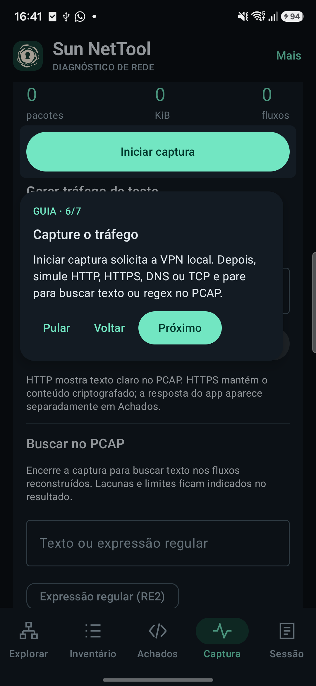
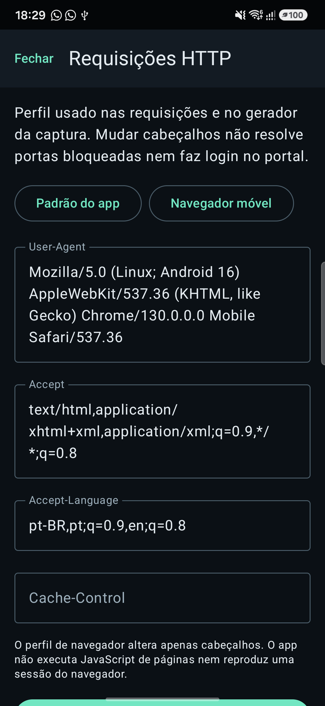

# Sun NetTool Android

MVP nativo em Kotlin e Jetpack Compose para diagnóstico e investigação de redes Wi-Fi, sem root, com evidências locais e ações iniciadas pelo usuário. Android **10 ou superior**, processadores **arm64-v8a ou x86_64**. Versão atual: **0.6.0**.

> **Exclusivamente para estudos. Uso por sua conta e risco. Recomendado apenas em ambientes e redes controladas, com autorização explícita dos responsáveis.** Não execute descoberta, testes de portas ou captura em redes de terceiros sem autorização.

## Baixar e instalar, sem compilar

1. Abra [Releases](https://github.com/sunsecrn/sun-net-tool/releases) e escolha uma versão publicada. Se a lista estiver vazia, ainda não há APK de release disponível: a assinatura está pendente de configuração pelo mantenedor.
2. Baixe `sun-net-tool-vX.Y.Z-release.apk`, `SHA256SUMS` e `BUILD-INFO.txt` da mesma versão. O arquivo “Source code” não é instalável.
3. Confira o SHA-256 do APK contra a linha correspondente de `SHA256SUMS`: Linux `sha256sum arquivo.apk`, macOS `shasum -a 256 arquivo.apk` ou PowerShell `Get-FileHash arquivo.apk -Algorithm SHA256`. O checksum detecta alteração do arquivo, mas não substitui a confiança na origem. O certificado de assinatura fica em `BUILD-INFO.txt`.
4. No Android, abra o APK e autorize temporariamente a instalação por esse navegador/gerenciador quando solicitado. Depois desative essa permissão. Não ignore alertas de assinatura ou origem desconhecida.
5. Abra o app e conecte-se ao Wi-Fi autorizado. A captura solicita consentimento de VPN e se limita ao NetTool. Nenhuma varredura começa apenas ao abrir o app.

**Debug não é release.** [Actions](https://github.com/sunsecrn/sun-net-tool/actions/workflows/android-ci.yml) gera um artefato `debug-<commit>` com APK de desenvolvimento e checksum, retido por sete dias (download geralmente exige login). Builds de PR são código não confiável; não instale apenas por haver um artefato. A chave debug de runners efêmeros não é estável. Não há garantia de atualização sobre um debug anterior ou sobre release. O Android exige certificado compatível e `versionCode` adequado para atualizar preservando dados; não desinstale sem exportar o que precisar, pois a desinstalação apaga dados locais.

## Funcionalidades reais

- Contexto Wi-Fi, endereços, rotas, gateway e DNS; descoberta limitada e testes TCP explícitos.
- Consultas DNS e descoberta de serviços; inventário com origem das evidências.
- HTTP GET com redirects limitados, headers, TLS validado, referências HTML/JavaScript e indícios mascarados.
- Versões anunciadas, observações de segurança e consulta manual de possíveis CVEs por CPE na NVD. Correspondência não comprova vulnerabilidade.
- Captura VPN apenas do próprio app, encaminhamento TCP/UDP, PCAP, busca textual/RE2 e exportação explícita.
- Sessões JSON/CSV, retenção limitada, diário debug opcional e guia nos controles.
- Localização opcional do aparelho durante o uso em primeiro plano, mediante ativação e permissão; exportações podem incluir coordenadas. Isso não localiza o serviço remoto.

Sessões permanecem no armazenamento privado do app até exportação explícita. Diagnósticos contatam os alvos escolhidos; a consulta manual à NVD envia CPE ao serviço externo. PCAP pode conter payload e dados sensíveis: não publique exportações.

## Prints reais do Android

Capturas de versões anteriores (0.3.2 e 0.4.0), selecionadas e revisadas sem endereços de rede, alvos, identificadores de sessão ou credenciais visíveis. A navegação da versão atual pode diferir.

| Guia de captura | Configuração HTTP |
| --- | --- |
|  |  |

## Compilar

Requer JDK 17, Android SDK 35, Build Tools 35.0.0, NDK 27.2.12479018 e CMake 3.22.1. Configure `ANDROID_HOME` ou `sdk.dir` em `local.properties` (não versionado).

```sh
sdkmanager 'platforms;android-35' 'build-tools;35.0.0' 'ndk;27.2.12479018' 'cmake;3.22.1'
./gradlew --no-daemon :app:testDebugUnitTest :app:lintDebug :app:assembleDebug
adb install -r app/build/outputs/apk/debug/app-debug.apk
```

No Windows, use `gradlew.bat`. O wrapper baixa Gradle 8.9 e verifica SHA-256. O debug usa a chave de desenvolvimento local do Android; não a publique nem a use como chave de distribuição.

```sh
./gradlew --no-daemon :app:testReleaseUnitTest :app:lintRelease :app:assembleRelease
```

O resultado `app/build/outputs/apk/release/app-release-unsigned.apk` **não está assinado nem pronto para instalar**. A assinatura de distribuição é uma etapa separada, descrita em [Publicação segura](docs/RELEASING.md). Nenhuma chave de release faz parte do projeto.

## CI e distribuição

O [CI](.github/workflows/android-ci.yml) testa, executa lint e compila debug em PRs e em `main`, com acesso somente de leitura e sem segredos de assinatura. O [workflow de Release](.github/workflows/android-release.yml) é manual em `main`: valida tag existente e versão, recompila release sem segredos, assina em job separado e cria apenas um **rascunho** com APK, fonte correspondente, checksum e certificado. Nunca promove artefatos de PR. Consulte [configuração e bloqueios](docs/RELEASING.md).

## Detalhes e limitações

## Caminho funcional

1. Conecte o telefone ao Wi-Fi. O contexto mostra a interface física, endereços/prefixos reais, gateway, DNS e sinalização de portal do Android.
2. Descubra até 256 alvos de um CIDR ou informe IP/domínio. Redes maiores oferecem lotes /24 explícitos, com até 16 sugestões; nenhuma seleção equivale à cobertura completa da rede. Não responder é inconclusivo.
3. Consulte DNS A/AAAA/PTR. Um IP observado vira alvo selecionável. DNS-SD limitado a HTTP/IPP/SSH está disponível no Android 13+ com Network explícita.
4. Teste até 1.000 portas TCP em um alvo selecionado, com 16 conexões simultâneas. O perfil comum importa o arquivo oficial nmap-services; a base não é redistribuída no APK. Domínios são resolvidos antes do scan; os demais IPs ficam disponíveis no inventário. OPEN, REFUSED, TIMEOUT e ERROR são separados. A opção de identificar serviços inspeciona até 16 portas abertas após o scan, usando HTTP, SSH ou TLS em portas compatíveis; o nome exige resposta de protocolo.
5. Inspecione uma URL com GET, até oito redirects, limite de corpo de 64 KiB, tempos DNS/TCP/TLS/HTTP, headers e TLS validado. Referências HTTP, HTML e JavaScript entram no inventário. A opção de scripts acessa até cinco scripts da mesma origem, sem recursão. Padrões de segredo geram somente indícios mascarados, sem validação online.
6. Inicie captura após consentimento Android. Ela inclui somente NetTool neste MVP. Use probes HTTP, HTTPS, DNS ou TCP para exercitar a VPN. Após encerrar, busque texto ou regex RE2 no PCAP, com reconstrução TCP limitada. Pare para exportar PCAP e metadados JSON/CSV. Os fluxos observados entram nas evidências da sessão.
7. Exporte a sessão em JSON/CSV. Até 20 sessões e 4.000 registros por sessão ficam no armazenamento privado; descartes são contabilizados. Até 300 registros recentes aparecem na lista, exportações incluem todos os retidos.

Diagnósticos usam a Network Wi-Fi, incluindo Wi-Fi sem internet, ou a Network VPN do app enquanto a captura está ativa. Mudança/perda da rede cancela a operação. A captura usa sockets protegidos contra loop e vinculados ao mesmo Wi-Fi. Não há fallback celular intencional.

## Limitações explícitas

- A captura é real, com encaminhamento TCP/UDP zdtun; está restrita ao próprio aplicativo. Com captura ativa, os diagnósticos iniciados pelo app usam a VPN; a saída do encaminhador permanece vinculada ao Wi-Fi físico.
- Não há MITM, leitura universal de HTTPS, captura de outros aparelhos, raw scans, root, fingerprinting de SO, ICMP/traceroute nem enumeração completa de VLANs/IPv6.
- O teste de portal registra status e redirects de uma consulta HTTP, sem confirmar sozinho autenticação obrigatória. O login fica no Android/navegador. Cookies reutilizados, comparação automática antes/depois, SPAs e correlação DNS temporal de fluxos não são implementados.
- Não há MAC/fabricante nem banco local de vulnerabilidades. A consulta manual à NVD sugere correspondências por CPE, sem comprovar falhas. Chave pública, token e recurso público não provam falha.
- O cliente HTTP faz GET sem credenciais configuráveis. Redirecionamento HTTPS para HTTP é registrado sem ser seguido. TLS inválido produz diagnóstico, nunca bypass.
- PCAP contém payload original e pode conter informações sensíveis. Só sua exportação explícita entrega esses bytes; relatórios textuais mascaram credenciais conhecidas, queries e amostras de padrões sensíveis.
- Histórico não é banco relacional completo. Evidências têm parentId/origem, entidades são derivadas de registros. DNS-SD registra até 40 anúncios, resolve apenas um simultaneamente e pode deixar anúncios sem resolução.
- Rotação mantém o modelo; saída definitiva da atividade interrompe operações. Captura segue em foreground até parada, limite, revogação ou perda do Wi-Fi. Estado visual de capturas antigas não é restaurado após morte do processo; arquivos privados permanecem sujeitos à retenção.

Veja [CAPTURE.md](CAPTURE.md), [THIRD_PARTY_NOTICES.md](THIRD_PARTY_NOTICES.md) e [teste nativo](tests/native/README.md) para motor, licença, reconstrução e limites de captura.

## Validação

Build debug, testes unitários e Android lint são executados. Testes cobrem CIDR, limites, DNS comprimido, mascaramento, CSV, parser de pacotes, PCAP e filtros/retenção do debug. Há teste nativo de encaminhamento TCP/UDP e proteção recusada usando somente loopback.

Teste físico inicial: Samsung S23 SM-S911B, Android 16/API36. Abertura, contexto Wi-Fi, HTTP HTTPS e captura DNS/HTTPS bidirecional exercitados. O teste nativo TCP/UDP passou no aparelho. O A17 também passou no teste nativo e no ensaio controlado de descoberta, 1.000 portas e HTTP/JS da versão 0.3.0. Versões anteriores do Android não foram testadas. Alinhamento ELF/ZIP de 16 KiB verificado no build; isso não substitui teste em aparelho com páginas de 16 KiB.

## Referências técnicas

- [Android Network](https://developer.android.com/reference/android/net/Network)
- [DnsResolver](https://developer.android.com/reference/android/net/DnsResolver)
- [NsdManager](https://developer.android.com/reference/android/net/nsd/NsdManager)
- [VpnService](https://developer.android.com/develop/connectivity/vpn)
- [zdtun](https://github.com/emanuele-f/zdtun)

## Créditos

Agradecimento à comunidade Sunsec, que ajuda nas pesquisas para o desenvolvimento destes aplicativos. [Comunidade Sunsec](https://sunsec.net).


## Debug opcional (0.2.0)

Em Sessão > Registro debug, ative o diário local antes de reproduzir um problema. Ele registra eventos de interface, mudanças de rede, operações e resultados sanitizados. Exportar debug JSON salva via seletor Android. Começa desligado, tem limites e não registra digitação ou payloads. Veja [DEBUG.md](docs/DEBUG.md). Os relatórios históricos dos aparelhos ficam somente no ambiente local.

## Inventário e achados (0.3.0)

A navegação tem Explorar, Inventário, Achados, Captura e Sessão. Explorar mantém a lista de IPs e domínios com Mais recon. Inventário separa IPs, domínios e serviços. A porta aberta recebe tipo somente após evidência de protocolo. Achados apresenta respostas HTTP, cabeçalhos, referências e indícios mascarados. Exportações e histórico ficam em Sessão.

O perfil de 1.000 portas usa frequências da base importada, ordenação decrescente e desempate por porta crescente. Obtenha [nmap-services oficial](https://raw.githubusercontent.com/nmap/nmap/master/nmap-services), salve no aparelho e use Importar nmap-services. A [licença da base](https://nmap.org/npsl/) acompanha o Nmap; ela não faz parte do APK nem do ZIP deste projeto. Uma lista personalizada de até 1.000 portas continua disponível sem importação. A retomada usa os resultados anteriores do mesmo IP e conexão Wi-Fi; uma troca de rede exige novo teste.

O laboratório local reproduz HTTP, redirects, JS com dados sintéticos, HTTPS autoassinado e banner SSH. Consulte [LAB.md](docs/LAB.md). Os alvos do laboratório não são pré-carregados no inventário do aplicativo.

## Guia nos controles (0.3.2)

O primeiro acesso apresenta sete destaques sobre os controles reais: conexão Wi-Fi, descobrir hosts, testar portas, filtros do inventário, executar HTTP, iniciar captura e exportar JSON. O Compose Showcase escurece o restante da tela e mantém uma explicação curta junto do controle. O guia troca de aba e rola até o alvo, com Próximo, Voltar, Pular e Concluir.

Tocar no controle destacado encerra o guia e executa a ação escolhida. Avançar pelos passos não inicia diagnósticos nem permissões. A etapa fica salva separadamente das sessões; encerrar o app permite retomar. Concluir ou pular encerra a apresentação automática. Mais > Modo tutor repete o guia e fica indisponível durante operações ou captura. A nova apresentação aparece uma vez também para quem já dispensou o antigo tutor textual.

## Investigação e debug local 0.4.0

A barra inferior usa Rede, Alvos, HTTP, Captura e Sessão, sem rótulos quebrados. Alvos reúne IPs, domínios, serviços, respostas HTTP, referências, indícios, DNS e sinais de portal. HTTP fica dedicado à execução das requisições e encaminha para os resultados em Alvos.

Mais > Debug da sessão mostra tentativas, erros e contexto local com filtros, busca e detalhes. Tentativas negativas de portas são agrupadas por operação, alvo, resultado e causa em lotes de 100, preservando porta e tempo de cada tentativa. Até 4.000 grupos/eventos continuam sendo retidos; se esse limite for atingido, grupos negativos são removidos antes das demais evidências e o descarte fica contabilizado. O diário opcional de eventos do app mantém seus limites separados.

Rede diferencia o próprio aparelho, gateway e DNS. Usar gateway preenche o alvo; Investigar DNS da rede faz PTR do gateway, servidores DNS e até 32 IPs observados, além de consultar até oito sufixos informados pela rede. mDNS continua como complemento para anúncios locais. Rotas são mostradas como contexto, sem assumir descoberta de outras VLANs.

Mais > Configurar HTTP oferece perfil do app, perfil de navegador móvel e edição de User-Agent, Accept, Accept-Language e Cache-Control. O mesmo perfil atende HTTP e o gerador da captura. Não há cookies ou credenciais nesse perfil e ele não substitui autenticação nem resolve bloqueios TCP. O gerador da captura tem exemplos HTTP/HTTPS/DNS/TCP preenchidos, atalho para gateway e serviços HTTP observados; nada é enviado sem ação do usuário.

O laboratório inclui redirects de portal sintético, resposta 204 e eco dos cabeçalhos de compatibilidade. O login real de captive portal e o roteiro da rede conhecida continuam exigindo ensaio próprio.


### Análise de segurança 0.5.0

Alvos > Segurança reúne versões anunciadas, observações contextuais de headers e consulta manual de possíveis CVEs pela NVD. Cada achado preserva evidência e origem; correlação de versão não é confirmação de vulnerabilidade. A consulta externa envia somente CPE e mostra limites/falhas explicitamente. Veja docs/USO-RAPIDO.md e [validação de empacotamento](docs/PACKAGING-VALIDATION.md).
